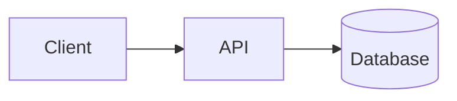

<!--
README template.
- Replace every <...> with real content.
- Sections marked OPTIONAL are commented out: uncomment only when they have real content.
- Base sections (Requirements, Installation, Usage, License) are active by default: delete any that does not apply.
- Never leave empty sections or "..." placeholders: if it does not apply, delete it.
- The short description lives in the blockquote under the title; do not duplicate it in another section.
-->

# <Project name>

<!-- Badges: uncomment only the ones that are true.

License (requires a LICENSE file at the repo root):
[](LICENSE)

Version (requires releases; updates automatically):
[](https://github.com/<owner>/<repo>/releases)
-->

> <One or two lines: what it is, who it is for, what problem it solves.>

<!-- Index: only for long READMEs. If you add one, verify anchors on the target platform (accents work on GitHub but not on every renderer).

## Index

- [Requirements](#requirements)
- [Installation](#installation)
- [Usage](#usage)
- [License](#license)
-->

<!-- OPTIONAL: demo. Only if there is something real to show.

## Demo

<Live URL, screenshot, or GIF.>
-->

<!-- OPTIONAL: features. Useful in libraries and tools; avoid repeating the description.

## Features

- <Feature 1>
- <Feature 2>
-->

## Requirements

- <Runtime and minimum version, e.g. Node.js 20+>
- <System dependencies, if any>

## Installation

```bash
<install commands>
```

<!-- OPTIONAL: configuration. Only if there are real options to configure.

## Configuration

<Environment variables, config file, options table...>
-->

## Usage

```bash
<minimal working example>
```

<!-- OPTIONAL: architecture / high-level how-it-works. Mermaid only when the flow or relationships are genuinely non-obvious. Keep it legible: one idea, <= 15 nodes, <= 20 edges, short labels. Function-level detail belongs in docs/<topic>.md. See the skill's "Diagrams (Mermaid)" rules.

## Architecture



<One line explaining what the diagram shows.>
-->

<!-- OPTIONAL: project structure. Useful in large repos; delete if it adds noise.

## Project structure

```text
<folder tree>
```
-->

<!-- OPTIONAL: tests.

## Tests

```bash
<test command>
```
-->

<!-- OPTIONAL: technologies. Short list; avoid filler.

## Technologies

- <Technology 1>
- <Technology 2>
-->

<!-- OPTIONAL: project status. Recommended for early-stage or paused projects.

## Project status

<Early development / maintained / paused / archived. What works and what does not.>
-->

<!-- OPTIONAL: roadmap. If you already use Issues/Milestones, link there instead of duplicating.

## Roadmap

- [ ] <Next milestone>
- [ ] <Following milestone>
-->

<!-- OPTIONAL: contributing. Enable if you accept contributions; link CONTRIBUTING.md when it exists.

## Contributing

Contributions are welcome: open an issue or a pull request. See <CONTRIBUTING.md>.
-->

## License

<Write this section only when a LICENSE file exists, e.g.: This project is distributed under the MIT license (see [LICENSE](LICENSE)). If there is no license, delete this section.>

<!-- OPTIONAL: contact. GitHub Issues already provides a channel; enable only if you offer a direct one.

## Contact

- <Email or social profile>
-->
