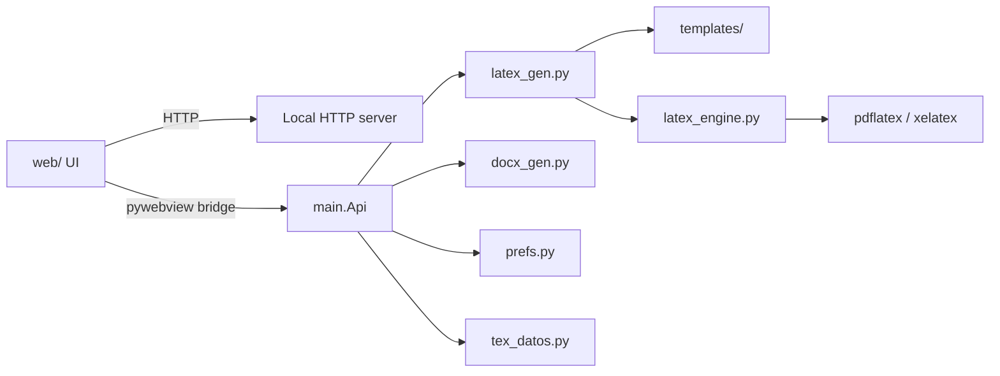

# Development

How to set up, test, build and extend CVLaTeX. The user-facing guide is [README](../README.md); the contribution workflow is [CONTRIBUTING](../CONTRIBUTING.md).

## Prerequisites

- Python 3.12 and pip. CI builds with Python 3.12; newer versions generally work but are not covered by CI.
- Python packages: `requirements.txt` (`pywebview`, `python-docx`, and `pyinstaller` for builds); `requirements-dev.txt` adds `pytest`. Both files pin the tested versions with `==` so a local run and CI install the same releases.
- The webview engine for your OS:
  - **Windows 10/11:** WebView2 runtime (preinstalled on current Windows).
  - **macOS:** the built-in WKWebView.
  - **Linux:** WebKitGTK 4.1 and GObject introspection at runtime: `python3-gi` and `gir1.2-webkit2-4.1` on Debian/Ubuntu (`python-gobject` and `webkit2gtk-4.1` on Arch); the WebKitGTK 4.1 runtime library is pulled in by these packages. Building a bundle additionally requires `libwebkit2gtk-4.1-dev` on Debian/Ubuntu, because PyInstaller must import `gi` and the GTK backend.
- Optional: Node.js for `node --check`, and a LaTeX engine (`pdflatex`/`xelatex`, or the TinyTeX installer in the app) for the PDF compile tests.

## Setup

Create the virtual environment at `.venv` so the commands in this document and the build scripts find it.

### Linux

```bash
sudo apt-get update
sudo apt-get install -y python3-gi gir1.2-webkit2-4.1 python3-venv
python3 -m venv --system-site-packages .venv
.venv/bin/pip install -r requirements.txt -r requirements-dev.txt
```

Add `libwebkit2gtk-4.1-dev` only when you build a bundle; it is a build-time dependency, not a runtime one.

The `--system-site-packages` flag is mandatory: PyGObject lives in the distribution's site-packages, and a plain venv hides it. Without it `main.py` fails with `You must have either QT or GTK...`, and a bundle built from that venv fails the same way on the target machine. `build.sh` detects a venv that cannot import `gi` and recreates it with the flag.

### macOS

```bash
python3 -m venv .venv
.venv/bin/pip install -r requirements.txt -r requirements-dev.txt
```

### Windows

```powershell
python -m venv .venv
.venv\Scripts\pip install -r requirements.txt -r requirements-dev.txt
```

## Run

Linux/macOS:

```bash
.venv/bin/python main.py
```

Windows:

```powershell
.venv\Scripts\python.exe main.py
```

The app opens a pywebview window and blocks until it is closed.

## Tests

The full suite (no GUI, no browser, no network):

```bash
.venv/bin/python -m pytest tests -q
```

The current tree reports **726 passed**. That count assumes a LaTeX engine is available: the PDF compile tests use `pytest.mark.skipif` and are skipped, not failed, when `pdflatex`/`xelatex` are missing, so a machine without LaTeX reports fewer passes plus skips. On Windows use `.venv\Scripts\python.exe -m pytest tests -q`.

Run one module or one test:

```bash
.venv/bin/python -m pytest tests/test_esquema.py -q
.venv/bin/python -m pytest tests -q -k sample
```

### Backend smoke check

Builds a `.tex` from the empty schema without a GUI or LaTeX:

```bash
.venv/bin/python -c "import latex_gen, prefs; print(latex_gen.build_tex(latex_gen.empty_data(), prefs.load())[:120])"
```

### LaTeX round-trip check

Embeds the data block in a generated `.tex` and extracts it again; no GUI and no LaTeX engine:

```bash
.venv/bin/python -c "import latex_gen, prefs, tex_datos; d=latex_gen.empty_data(); t=tex_datos.embed(latex_gen.build_tex(d, prefs.load()), d); assert tex_datos.extract(t)==d; print('round-trip OK')"
```

### Frontend syntax

The frontend has no build step. `pytest` never runs Node; the suite checks the frontend statically. If Node is installed, validate the scripts directly:

```bash
node --check web/app.js
node --check web/i18n.js
```

## Build

Build natively on each platform; PyInstaller bundles are not portable across operating systems.

```bash
./build.sh        # Linux -> dist/CVLaTeX_Linux; macOS -> dist/CVLaTeX_macOS.zip + dist/CVLaTeX.app
build.bat         # Windows -> dist/CVLaTeX_Windows.exe
```

`build.sh` creates or reuses `.venv`, installs `requirements.txt` when needed, checks the Linux webview packages, generates the macOS `.icns` when `sips`/`iconutil` and `assets/CVLaTex.png` are available, and runs PyInstaller with `--onefile --windowed --add-data "web:web" --add-data "templates:templates"`. `build.bat` expects an already-created `.venv` with the requirements installed and uses the Windows `;` separator in `--add-data`.

Both scripts name the PyInstaller app `CVLaTeX` and then rename or zip the result to the platform-suffixed bundle. Keep those names in sync with `.github/workflows/build.yml` and the README when renaming.

## Architecture



The UI is loaded over HTTP and talks back through the pywebview bridge; generation is split between LaTeX and Word.

- `main.py` is the pywebview shell and the local HTTP server on a random `127.0.0.1` port. The server serves `web/` at `/`, compiled PDFs from `cache/build` at `/preview/`, uploaded media from the cache at `/media/` and the vendored PDF.js viewer at `/pdfjs/`. `class Api` is the JavaScript bridge exposed as `window.pywebview.api`.
- `latex_gen.py` owns the canonical schema (`empty_data()`), the `LANG` label tables (es/en/zh), `build_tex(data, prefs.load())`, `esc()` for every user-injected TeX value, section order/visibility/custom titles, free blocks, document colors and `TEMPLATES`/`TEMPLATE_FILES`.
- `latex_engine.py` resolves `pdflatex` (preference, app-managed TinyTeX, `PATH`), finds `xelatex`, switches to XeLaTeX for CJK text or a `fontspec` preamble, serializes compiles with a lock, clears the build cache, parses errors from `main.log` and implements the cancelable TinyTeX installer.
- `docx_gen.py` writes Word with python-docx and mirrors section order/visibility/titles, blocks and the color palette. It never needs a LaTeX installation.
- `tex_datos.py` embeds the base64 JSON data block in `% CVLaTeX-DATA-BEGIN` / `% CVLaTeX-DATA-END` comments and extracts it on import. Foreign `.tex` files are rejected rather than parsed heuristically.
- `prefs.py` stores JSON preferences in the per-OS app data directory (`%LOCALAPPDATA%\CVLaTeX`, `~/Library/Application Support/CVLaTeX`, `$XDG_DATA_HOME/CVLaTeX` or `~/.local/share/CVLaTeX`) with a module-level cache.
- `messages.py` holds backend user-facing strings and `ejemplo.py` the localized sample CV (es/en/zh).
- `web/` contains `index.html`, `app.js`, `i18n.js`, `style.css` and the vendored `pdfjs/` viewer. Edit files directly and reload; there is no npm, bundler or transpiler.

## Project structure

```text
main.py                       pywebview shell, Api bridge, HTTP server, .cvjson I/O
latex_gen.py                  schema, LANG tables, build_tex, rendering
latex_engine.py               engine resolution, TinyTeX, compile lock
docx_gen.py                   Word export (python-docx)
tex_datos.py                  embedded base64 data block for .tex
prefs.py                      per-OS app data directory and preferences
messages.py                   backend user-facing strings (es/en/zh/ru)
ejemplo.py                    localized sample CV (es/en/zh)
version.py                    release version (single source of truth)
templates/<name>/<file>.tex   one LaTeX template per layout
web/                          index.html, app.js, i18n.js, style.css, pdfjs/
tests/                        pytest suite (no GUI, no browser)
build.sh / build.bat          PyInstaller builds
CHANGELOG.md / SECURITY.md    release notes and security policy
THIRD_PARTY_NOTICES.md        third-party licenses and provenance
.github/workflows/build.yml   CI: tests + build matrix (no publishing)
.github/workflows/release.yml tag-driven test, build and GitHub Release
```

## Adding a template

1. Create `templates/<name>/<file>.tex` based on an existing template.
2. Define `\cvblockline`, `\cvblockband` and `\cvblockspace` for the free-block separator, band and space, and keep the `{{...}}` placeholders that `build_tex()` fills: `{{font_size}}`, `{{paper}}`, `{{margin_top}}`, `{{margin_bottom}}`, `{{margin_left}}`, `{{margin_right}}`, `{{font_engine}}`, `{{header}}` and `{{body}}`. Sidebar variants also use `{{sidebar}}`.
3. Add the id to `TEMPLATES` and the file path to `TEMPLATE_FILES` in `latex_gen.py`. If the layout reuses the Chinese three-column renderers, also add it to `CHINESE_STYLE_TEMPLATES`.
4. Add `{ value: "<name>", labelKey: "template_<label>" }` to `TEMPLATES_CV` in `web/app.js` (`<label>` is the id with hyphens replaced by underscores, e.g. `template_sidebar_right`).
5. Add the menu entry `<a data-accion="template:<name>">` with its `data-marca="template-<name>"` mark to the template submenu in `web/index.html`.
6. Add the `template_<label>` string to all four tables in `web/i18n.js` (es/en/zh/ru), and extend the frontend tests that pin the 11-template menu.
7. Run the suite. The template is exercised automatically by the tests parametrized over `latex_gen.TEMPLATES`.

Placeholders in comments are stripped before substitution, so documentation comments containing `{{...}}` are safe.

## Adding a data field

Add the field in all three places:

1. `latex_gen.empty_data()` in `latex_gen.py`, with the canonical key and default value.
2. `main.migrate_data()` in `main.py`: translate legacy keys through `_DATA_RENAMES` or the per-entry maps, and normalize the value if it is a select or a list. `main.fill_defaults()` derives its defaults from `empty_data()`, so existing files receive the new key automatically.
3. `CLAVES_ESPERADAS` in `tests/test_esquema.py`, which asserts the exact key set.

Then wire the UI in `web/app.js` and add every new user-visible string to all four `web/i18n.js` tables. If the field is exported to Word, update `docx_gen.py` too.

## Internationalization

- `web/i18n.js` has four UI tables (`es`, `en`, `zh`, `ru`) with identical key sets; English is the default and the fallback. `OPTION_LABELS` mirrors the backend select labels.
- `messages.py` has the same four languages with identical key sets for backend messages.
- `latex_gen.LANG` holds the CV labels in `es`, `en` and `zh`; Russian is UI-only and is not a document language.
- Never hardcode a user-visible string. Add it to `web/i18n.js` or `messages.py` (all four languages) and reference the key.
- UI language (`ui_language`) and document language (`cv_language`) are separate. `Api.empty_data()` maps the UI language to the document language for a new CV (Russian falls back to English); saved CVs keep their own `cv_language`.
- Brand names (GitHub, LinkedIn, X, etc.) are never translated.

## Frozen contracts

- The public bridge surface of `main.Api` is frozen. `tests/test_frontend.py` and `tests/test_main_bridge.py` pin the method names, the `data-accion` values and the DOM ids; renaming one requires updating the tests and the frontend in the same change.
- Response envelope keys are frozen: `ok`, `errores`, `ruta`, `cancelado`, `datos`, `colores`. `autosave_read()` returns plain data, never the v3 envelope. `export_cv(data, path=None)` writes directly when a path is given and opens the dialog when it is `None`.
- The `.cvjson` v3 format is `{"version": 3, "data": ..., "media": {path: {name, b64}}}`. v1/v2 files are migrated after copying to `<file>.v2.bak` (never clobbering an existing backup).
- `section_order: []` is the "default order" sentinel; keep it on load and expand it with `normalize_section_order()` only when rendering.
- `Api._push()` must keep `ensure_ascii=True`. pywebview's GTK backend passes the character length of the script to WebKit's `evaluate_javascript()`, which expects bytes; any raw non-ASCII character truncates the script and the push is lost with `SyntaxError: Unexpected EOF`. Escaping non-ASCII keeps the script pure ASCII. Tests check this for every template and CV language.
- The close guard must not call `evaluate_js` synchronously from `_on_closing`; it runs on the WinForms UI thread and deadlocks. Push `__onCloseRequest` from a daemon thread and cancel the close.

## Linux PDF preview

WebKitGTK cannot render PDFs inline, so on Linux `app.js` loads the vendored PDF.js viewer at `/pdfjs/viewer.html?file=/preview/main.pdf` into `#pdf` instead of pointing the iframe at the PDF. The viewer reports readiness or failure to the parent page; on failure the notice above the preview appears and `Api.open_preview()` opens the last compiled PDF with the system default viewer. Windows and macOS keep the native PDF viewer.

`web/pdfjs/` contains PDF.js 3.11.174 (`pdf.min.js`, `pdf.worker.min.js`) and CVLaTeX's minimal `viewer.html`; see [web/pdfjs/README.md](../web/pdfjs/README.md) for provenance and update steps. `webview.settings["ALLOW_DOWNLOADS"] = True` is required for the viewer's save dialog, because pywebview cancels downloads by default.

The Linux bundle must include `web/pdfjs/` through `--add-data "web:web"`; a missing folder is the usual cause of a blank Linux preview.

## Testing strategy

- No GUI and no browser: importing `main` does not open a window, and the frontend is checked by parsing the files.
- There is no `conftest.py`. Every module that touches preferences defines its own `prefs_tmp` fixture, monkeypatching `prefs.APP_DIR`, `prefs.CACHE_DIR`, `prefs.BUILD_DIR`, `prefs.PREFS_FILE` and `prefs._CACHE` to a temporary directory. New test modules must do the same.
- Real PDF compiles are guarded with `pytest.mark.skipif` on `latex_engine.find_pdflatex()`/`find_xelatex()` and skip when no engine is available; the build_tex/embed/extract round-trip always runs.
- Rendering tests are parametrized over the templates and the CV languages, so a template or label change is covered without writing a test per combination.
- `tests/test_frontend.py` pins exact frontend strings, DOM ids, `data-accion` values and bridge names; `tests/test_esquema.py` pins the schema key set. Update the tests in the same change when you rename or add one.
- The suite does not run Node. Run `node --check` separately when you edit `web/app.js` or `web/i18n.js`. No linter, formatter or typecheck is configured; pytest plus `node --check` are the available checks.
- `tests/test_ejemplo.py` checks that the es/en/zh samples tell the same career story (same dates, links and entry counts) and never include images; a change in one language must not silently alter the structure of the others.

## CI and release notes

`.github/workflows/build.yml` runs on branch pushes, pull requests and manual dispatch with Python 3.12. Its `test` job installs `requirements.txt` + `requirements-dev.txt` and runs `pytest tests -q` on Ubuntu; the `build` job depends on it and builds on Windows, Ubuntu and macOS, uploading `CVLaTeX_Windows.exe`, `CVLaTeX_Linux` and `CVLaTeX_macOS.zip` as artifacts. It never publishes a GitHub release. The `push` trigger is restricted to branches, so a `v*` tag only starts the release workflow.

The Linux build job installs `python3-gi`, `python3-venv`, `gir1.2-webkit2-4.1` and `libwebkit2gtk-4.1-dev` before calling `PYTHON=/usr/bin/python3 ./build.sh`, so the build venv can import `gi`. Builds are per-platform: a bundle produced on one OS does not run on another.

`.github/workflows/release.yml` is triggered by `v*` tags, declares `permissions: contents: write` and runs `test` → `build` → `publish`. Publish verifies that the tag equals `version.__version__`, renames the artifacts to `CVLaTeX-v${VERSION}-windows-x64.exe`, `CVLaTeX-v${VERSION}-linux-x86_64` and `CVLaTeX-v${VERSION}-macos-<arch>.zip`, writes `SHA256SUMS.txt` and calls `gh release create "$GITHUB_REF_NAME" ... --generate-notes`, with `--prerelease` for `0.*`. It uses the workflow `GITHUB_TOKEN`; no PAT or workflow-scoped token is required.

`macos-latest` is an Apple Silicon (`arm64`) runner at the time of writing, so the first release is expected to publish `CVLaTeX-v0.1.0-macos-arm64.zip`. The build step maps `runner.arch` (`X64`/`ARM64`) to the suffix, so an Intel runner would publish `macos-x86_64` without a workflow change. There is no universal binary.

## Releasing

CVLaTeX follows [Semantic Versioning](https://semver.org/) and publishes from tags; only maintainers cut releases.

1. Bump the version in three places: `version.py` (`__version__`), the literal `vX.Y.Z` in the `#modal-credits` block of `web/index.html`, and the dated `## [X.Y.Z] - YYYY-MM-DD` section of `CHANGELOG.md`. Update the asset names in `README.md` and any test count in the docs if the suite changed.
2. Run the checks on a clean tree:

   ```bash
   node --check web/app.js
   node --check web/i18n.js
   .venv/bin/python -m pytest tests -q
   ```

3. Commit the release on `main`, create an annotated tag and push both:

   ```bash
   git tag -a vX.Y.Z -m "CVLaTeX vX.Y.Z"
   git push origin main --follow-tags
   ```

4. The tag starts `.github/workflows/release.yml`. Wait for the `test` and three-platform `build` jobs, then the `publish` job; it verifies the tag against `version.py`, normalizes the asset names, generates `SHA256SUMS.txt` and creates the GitHub Release (pre-release for `0.*`).
5. Verify the published release:

   ```bash
   gh release view vX.Y.Z
   gh release download vX.Y.Z --dir /tmp/cvlatex-vX.Y.Z
   cd /tmp/cvlatex-vX.Y.Z && sha256sum -c SHA256SUMS.txt
   ```

6. Do not move, delete or force-push a published tag. If `publish` fails after creating an incomplete release, delete that release (`gh release delete vX.Y.Z --yes`, **without** `--cleanup-tag`) and re-run the workflow (`gh run rerun <run-id>`); the tag stays in place. Never tag a commit whose test job is red.
